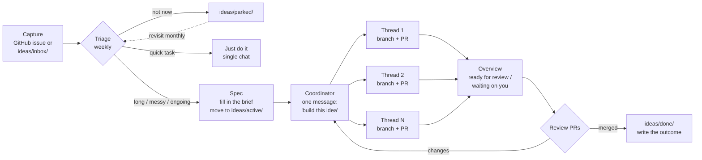

# Idea → Code process

One place to dump ideas, one chat (the coordinator) to turn them into work,
parallel threads to build them. Modeled on Claude Projects:
coordinator + threads + overview + instructions.



## Stages

| Stage | Where it lives | What you do | Done when |
|---|---|---|---|
| **1. Capture** | GitHub issue (label `idea`) from your phone, or `python tools/idea.py new "..."` | Write one sentence. No polishing. | It exists. |
| **2. Triage** | `ideas/inbox/` | Once a week: park it, do it now (quick task), or promote it. | Every inbox item has a decision. |
| **3. Spec** | `ideas/active/<idea>.md` | Fill in the brief: goal, done-looks-like, the split into pieces. | Each piece can be built without talking to the others. |
| **4. Build** | Coordinator chat → threads | Send one message pointing at the brief. Each piece becomes a thread with its own branch and PR. | Every thread has a PR or is blocked on you. |
| **5. Review** | Project overview + PRs | Answer the "waiting on you" items first, then review PRs. | PRs merged or sent back. |
| **6. Close** | `ideas/done/` or `ideas/parked/` | Write 2–3 lines on what shipped and what you learned. | File moved. |

## When to use threads vs. a single chat

Use the coordinator + threads for:
- **Multi-part builds** — the idea splits into pieces that can run in parallel.
- **An ongoing backlog** — an area you keep feeding new ideas into.
- **Overnight work** — cloud threads keep going while you're away.

Skip it for quick tasks, or when every step needs your own machine.
Threads burn plan limits faster than a single chat.

## Splitting an idea into threads

A good split:
- Each thread owns one piece and one branch. No two threads edit the same files.
- One thread owns anything shared (a data format, a config, a schema) and the
  others build against it. Name that owner in the brief.
- Anything that needs you (repo settings, API keys, accounts, payment) goes in
  the brief's **Needs me** list up front, so threads don't stall on it.

## Coordinator message template

```
Build the idea in ideas/active/<file>.md.
Split it into one thread per item under "Pieces". <Piece name> owns the shared
format; the others build against it. Each thread: own branch, open a PR, report back.
Put anything you need from me in "waiting on you".
```

## Settings (set once, gear icon in the project header)

| Setting | Value |
|---|---|
| Coordinator | Opus, low effort |
| Threads | Opus, medium effort (high by default; medium uses less) |
| Instructions | Short. This repo's `CLAUDE.md` is enough. |
| Repo + env | This repo; a cloud environment holding any API keys |
